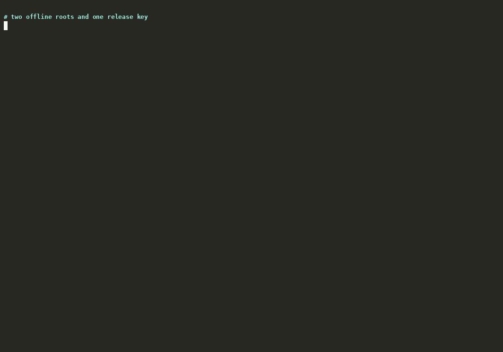

<h1>
  <picture>
    <source media="(prefers-color-scheme: dark)" srcset="branding/wordmark/lockup-dark.svg">
    
  </picture>
</h1>

A macOS agent that scans files downloaded from the internet in a sandboxed process against signed YARA-X and file-format rules.

[](https://www.bestpractices.dev/projects/17080)
[](https://github.com/tobiaskocur/pokey/actions/workflows/core-ci.yml)
[](https://github.com/tobiaskocur/pokey/actions/workflows/rules-ci.yml)
[](https://github.com/tobiaskocur/pokey/actions/workflows/macos-ci.yml)



Status: early. Every target builds and the tests pass in CI on Linux and macOS, but nothing has run on a real Mac with the Endpoint Security entitlement yet. Details and known gaps: [docs/deploying.md](docs/deploying.md#status).

## Components

| Process | Runs as | Does |
| --- | --- | --- |
| `pokey-sensor` | root, system extension | Filters Endpoint Security file events down to quarantined files, hashes them, hands them to an inspector, keeps verdicts. Never parses file contents. |
| `pokey-inspector` | `_pokeyinspect`, one process per file | Runs YARA-X, format schemas and an ImageIO decode in a sandbox with no network and no writes. |
| `pokey-netd` | `_pokeynet` | Downloads signed rule bundles, uploads telemetry. |
| `pokey-ui` | logged-in user | Shows alerts as notifications. |

The rule compiler and the scan engine are Rust (`core/`); the macOS processes are Swift (`macos/`).

## Building

Requires Rust 1.95 and Swift 6. The macOS targets need Xcode 16 and [XcodeGen](https://github.com/yonaskolb/XcodeGen).

Rust core and rule compiler (Linux or macOS):

```sh
cd core
cargo test --workspace --locked
cargo build --release -p pokey-rulec
```

Swift logic tests (Linux or macOS):

```sh
cd macos
make test
```

macOS targets and an unsigned app bundle:

```sh
cd macos
make build
make xcode XCODEBUILD_FLAGS="CODE_SIGNING_ALLOWED=NO"
```

Signing with your own team ID and Endpoint Security entitlement is described in [docs/deploying.md](docs/deploying.md).

## Usage

`pokey-rulec` lints, tests, compiles, signs and runs the rules in [`rules/`](rules):

```sh
# from the repo root
R=core/target/release/pokey-rulec
$R lint --rules rules --deny-warnings
$R test --rules rules --benign rules/benign --max-ms 50 --max-fuel-pct 50
$R compile --rules rules --version 1 --channel canary --expires-days 7 --out unsigned.bundle
$R scan --rules rules path/to/file.png
```

Run `pokey-rulec` with no arguments to list the key, certificate, signing and verification commands. The GIF above is [docs/demo/demo.sh](docs/demo/demo.sh).

## Install

Releases are on the [Releases page](https://github.com/tobiaskocur/pokey/releases). Each one has:

- `pokey-rulec` for Linux (x86_64, aarch64) and macOS (universal)
- `Pokey-<version>-unsigned-dev-only.zip`: the app with its system extension, unsigned. It does not run on a normal Mac; it is there to inspect or to sign yourself ([docs/deploying.md](docs/deploying.md)).
- `SHA256SUMS`, an SPDX SBOM and a build provenance attestation

Check a download:

```sh
sha256sum --check --ignore-missing SHA256SUMS
gh attestation verify pokey-rulec-x86_64-unknown-linux-gnu.tar.gz -R tobiaskocur/pokey
```

Changes per version are in [CHANGELOG.md](CHANGELOG.md). Rule bundles have their own version and release flow ([docs/rule-pipeline.md](docs/rule-pipeline.md)).

## Documentation

- [Architecture](docs/architecture.md): processes, IPC, data flow, source layout
- [Security model](docs/security-model.md)
- [Rule pipeline](docs/rule-pipeline.md): CI checks, signing, rule updates
- [Development](docs/development.md): checks CI runs, to run before a pull request
- [Deploying](docs/deploying.md): identity, entitlements, rule releases, current status
- [Contributing](CONTRIBUTING.md): commit messages, pull requests, releases
- [Security policy](SECURITY.md)

## License

Apache-2.0, see [LICENSE](LICENSE). The logo and fonts in [`branding/`](branding) have their own terms, see [branding/README.md](branding/README.md).
