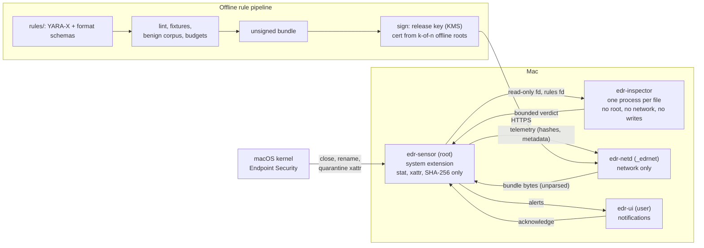

# macos-edr-agent

A defensive file-monitoring agent for macOS. It watches files that arrive from
the internet (anything carrying the `com.apple.quarantine` flag), checks them
in a throwaway sandboxed process against signed rules, and tells the user when
a file looks wrong, for example a PNG with a Mach-O binary glued to its end or
an image whose structure would trip up a decoder.

Why another one: image and document parsers are a common way into a Mac, and
most endpoint tools either trust the OS decoder or parse untrusted bytes inside
a privileged process. Here the only root process never reads file contents.
Parsing happens in a short-lived process that has dropped root, has no network,
cannot write files and is killed if it runs too long or uses too much memory.

> **Status: early, not production-ready.** The Rust core, the rule pipeline
> and the Swift logic are tested on Linux and macOS in CI, and every macOS
> target compiles. Nothing has run on a real Mac with the Endpoint Security
> entitlement yet. See [Project status](#project-status).


*The rule pipeline in the terminal: two offline roots certify a release key,
rules are tested and signed, one flipped byte makes the bundle invalid, and a
PNG with an appended Mach-O is flagged while a clean PNG passes. Recorded from
[`docs/demo/demo.sh`](docs/demo/demo.sh) with throwaway keys.*

## How it works



1. **Sensor** (`edr-sensor`, root, system extension). Gets file events from
   Endpoint Security, ignores files without the quarantine flag, debounces,
   opens the file once, checks it is still the same inode, hashes it, and looks
   up a verdict cache. On a miss it hands the open file descriptor to an
   inspector. It never parses file contents.
2. **Inspector** (`edr-inspector`). Spawned by the sensor, drops to the
   `_edrinspect` user, sets hard resource limits and enters a pure-compute
   sandbox before it gets a job. Stage 1 runs YARA-X and the structural schema
   checks; stage 2 asks ImageIO to read the image header and decode one frame.
   A watchdog in the sensor kills it on timeout or memory overuse; a crash or
   malformed reply is itself a verdict.
3. **netd** (`edr-netd`, `_edrnet`). Downloads signed rule bundles and uploads
   telemetry. It passes bundle bytes to the sensor without parsing them.
4. **ui** (`edr-ui`, per user). Shows notifications and lets the user
   acknowledge alerts through a short allowlist of commands.
5. **Host app** (`EDRHost`). Activates the system extension and registers netd
   and ui with `SMAppService`.

Full design and accepted risks: [docs/architecture.md](docs/architecture.md).

## Security model

- **One root process, no parsing in it.** The sensor's only untrusted inputs
  are inspector replies (strict, size-bounded schema), bundle bytes from netd
  (signatures checked over raw bytes before anything is parsed) and allowlisted
  ui commands.
- **Pinned peers.** Every XPC connection is pinned to a code-signing
  requirement built from the team ID and bundle prefix. An inspector must also
  be the sensor's own child and present a one-time nonce passed over a pipe.
- **Bounded rules.** Structural checks are written in a small schema language,
  compiled to IR in CI and run by a fuel-limited interpreter with
  bounds-checked reads. A schema cannot loop forever or read outside the file.
- **Signed, monotonic rule updates.** A bundle needs a signature from a release
  key whose certificate is signed by k of n offline roots. The sensor rejects
  older versions, expired bundles and bundles needing a newer engine, runs the
  bundle's self-tests in a fresh inspector before switching, and rolls back to
  the last known-good bundle if the health gate fails.
- **Telemetry** carries hashes and metadata. Download URLs are off unless the
  deployment turns them on.

## Rule pipeline

Rules live in [`rules/`](rules): YARA-X signatures, format schemas (PNG,
TIFF, ISO-BMFF/HEIC/AVIF), a policy file mapping outcomes to severity, fixtures
with expected outcomes and a benign corpus that must scan clean.

| Step | Where | What it checks |
| --- | --- | --- |
| Lint and compile | `rules` workflow, every PR | Rules compile on the current engine and on the previous engine release (`engine-v*` tag), which deployed sensors may still run |
| Fixtures | same | Each fixture produces its expected outcome and rule |
| False-positive gate | same | Every file in `rules/benign` scans `CLEAN` |
| Budgets | same | Per-file scan time and interpreter fuel stay under limits |
| Fuzzing | `core` workflow | Schema interpreter, compiler and bundle verifier under libFuzzer |
| Sign and publish | `release-rules`, manual only | Signs in the `rules-release` environment through a KMS/HSM signer command, verifies against the pinned roots, publishes a release |

`edr-rulec` does all of it locally:

```sh
cargo build --release -p edr-rulec --manifest-path core/Cargo.toml
R=core/target/release/edr-rulec
$R lint --rules rules --deny-warnings
$R test --rules rules --benign rules/benign --max-ms 50 --max-fuel-pct 50
$R compile --rules rules --version 1 --channel canary --expires-days 7 --out unsigned.bundle
$R scan --rules rules path/to/file.png
```

Run `edr-rulec` without arguments for key, certificate, signing and
verification commands.

## Build and test

Requirements: Rust 1.93.1. For the Swift parts, Swift 6 (macOS with Xcode 16,
or Linux for the platform-independent logic). For the app bundle, also
[XcodeGen](https://github.com/yonaskolb/XcodeGen).

```sh
# Rust core and rule tool
cd core
cargo fmt --all --check
cargo clippy --workspace --all-targets --locked -- -D warnings
cargo test --workspace --locked

# Swift logic tests (EDRCore, EDRRules), Linux or macOS
cd ../macos && make test

# macOS: all targets, then the unsigned app bundle
make build
make xcode XCODEBUILD_FLAGS="CODE_SIGNING_ALLOWED=NO"
```

## Project layout

| Path | What |
| --- | --- |
| `core/edr-core` | Rule bundles (format, signatures, verification), schema language, scan engine over YARA-X |
| `core/edr-ffi` | C ABI used from Swift ([`edr_core.h`](core/edr-ffi/include/edr_core.h)) |
| `core/edr-rulec` | Rule CLI: lint, test, compile, keys, certificates, sign, verify, scan |
| `core/fuzz` | cargo-fuzz targets |
| `rules/` | Rules, schemas, policy, fixtures and benign corpus |
| `macos/Sources/EDRCore`, `EDRRules` | Platform-independent Swift logic and the rules wrapper |
| `macos/Sources/EDRPlatform` | XPC, code-signing identity and configuration helpers |
| `macos/Sources/edr-sensor`, `edr-inspector`, `edr-netd`, `edr-ui`, `EDRHost` | The processes described above |
| `macos/project.yml`, `macos/Config` | XcodeGen project, identity, Info.plists, entitlements, launchd templates |

## Deploying it yourself

Nothing in the repository is a real identity. To build for your own fleet:

1. Put your values in `macos/Config/Identity.local.xcconfig` (not committed):
   team ID, bundle prefix, root threshold, rules and telemetry URLs, and the
   provisioning profiles that carry the Endpoint Security and system extension
   entitlements. Apple grants the Endpoint Security entitlement per developer
   team on request.
2. Put your offline root public keys in `macos/Config/trust-roots.txt`.
3. The installer runs `macos/scripts/create-users.sh` to create the
   `_edrnet` and `_edrinspect` accounts. The host app then activates the system
   extension and registers netd and ui. MDM (or the user) approves the system
   extension and grants the sensor Full Disk Access.
4. For rule releases, configure the `rules-release` environment with the
   signer command (`RULES_SIGNER_CMD`, reads the message on stdin and prints the
   Ed25519 signature), the release certificate and the root threshold, and
   protect it with required reviewers.

## Project status

| Area | State |
| --- | --- |
| Rust core, rule tool, fuzz targets | Tested in CI (Linux) |
| Swift logic (EDRCore, EDRRules) | Tested in CI on Linux and macOS |
| macOS targets and app bundle | Compile in CI on macOS (unsigned) |
| Endpoint Security events, system extension activation | **Not tested**: needs the ES entitlement and a signed, notarized build on a real Mac |
| Inspector sandbox, ImageIO stage, watchdog kills | **Not tested** on a device |
| Installer package, notarization | Not built yet |
| Telemetry server | Not part of this repository; netd POSTs JSON |
| Rule signing job | Prepared, never run; needs a signer and protected environment |

Known gaps by design: files without the quarantine flag (from `curl`, `git`,
archive tools) are not scanned; the agent alerts and does not block
(`AUTH_OPEN` deny lists and tamper resistance are planned).
