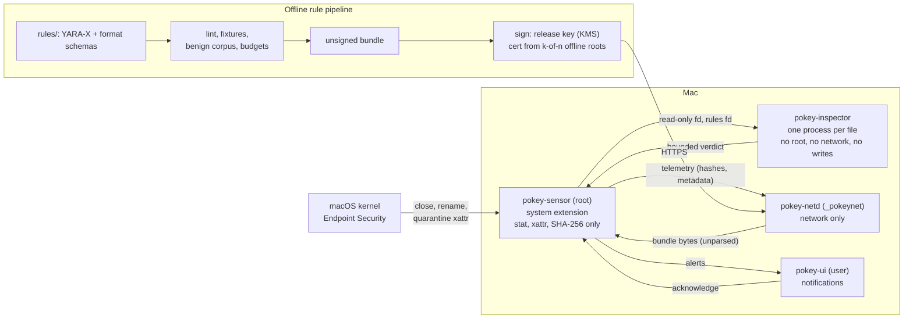

# Architecture (approved design, 2026-11-24)

Target: macOS 13+. Four processes plus an offline pipeline. Only the sensor runs as root and it never interprets file contents.

## Diagram

## Components

| Component | Runs as | Privileges | Parses untrusted bytes |
|---|---|---|---|
| pokey-sensor | root, System Extension (OSSystemExtensionRequest) | ES entitlement, Full Disk Access, no network | No (stat, xattr, SHA-256 only) |
| pokey-inspector | spawned by sensor, drops to `_pokeyinspect`, one process per file | FDs only, sandbox: no network, no writes, hard rlimits | Yes, the only one |
| pokey-netd | LaunchDaemon via SMAppService.daemon, user `_pokeynet` | network client only, no FDA, no writes | bundle bytes passed through unparsed |
| pokey-ui | per-user LaunchAgent | notifications, forwards user actions | No |
| Host app | /Applications | installs extension, registers daemons | No |

Sensor's only untrusted inputs: inspector replies (strict bounded schema), bundle blobs from netd (signature verified over raw bytes before parsing), allowlisted pokey-ui commands. ES messages are trusted.

## Ingestion (pokey-sensor)

- Subscribe NOTIFY_CLOSE (modified, also was_mapped_writable on 13+), NOTIFY_SETEXTATTR (com.apple.quarantine), NOTIFY_RENAME, NOTIFY_EXIT.
- Mute own processes (es_mute_process), system prefixes via es_mute_path TARGET_PREFIX; optional es_invert_muting to /Users, /Volumes.
- ES callback never blocks: copy dev, ino, path, seq_num, global_seq_num to a bounded queue; count drops and seq gaps.
- Candidate stage (serial queue): debounce per (dev, ino) ~500 ms; open O_RDONLY|O_NOFOLLOW|O_CLOEXEC; fstat must be S_ISREG and match event dev/ino; IOPOL_TYPE_VFS_MATERIALIZE_DATALESS_FILES off, skip SF_DATALESS; fgetxattr com.apple.quarantine required, parse `flags;hex-time;agent;UUID`, keep kMDItemWhereFroms as provenance; size limit; streamed SHA-256; verdict cache keyed (sha256, bundle_version); job journal in root-owned SQLite for restart.
- Documented scope gap: files without the quarantine xattr (curl, git, extractors) are never candidates.

## Inspection (pokey-inspector)

Lifecycle: sensor creates pipe with one-time nonce, posix_spawn; inspector drops root first (setgroups, setgid, setuid, verify setuid(0) fails); setrlimit hard CPU, FSIZE=0, CORE=0, small NOFILE, NPROC; XPC connect to sensor Mach service (NSEndpointSecurityMachServiceName), sensor accepts only spawned child PID + code-signing requirement + nonce; pre-warm decoders on built-in samples; sandbox_init(kSBXProfilePureComputation); send READY, one job, reply, exit. One pre-warmed worker kept ready.

Job (XPC dict): job_id, file_fd (xpc_dictionary_set_fd, read-only, pread only), size, format_hint, rules_fd, limits {max_bytes, max_pixels, deadline_ms}.

Staged results: Stage 1 = YARA-X + structural schema interpreter, result sent before any OS decoder runs. Stage 2 = ImageIO: CGImageSourceCopyPropertiesAtIndex, reject width*height over limit before decode, thumbnail decode (kCGImageSourceThumbnailMaxPixelSize), forced full decode of frame 0 (kCGImageSourceShouldCacheImmediately), frame count. AV media is v2.

Watchdog lives in the sensor: per-format wall-clock deadline then SIGKILL; poll proc_pid_rusage(RUSAGE_INFO_V4).ri_phys_footprint every 25-50 ms, kill over budget (e.g. 512 MB); waitpid for exit/signal.

Outcomes (reply validated, malformed = PROTOCOL_VIOLATION): CLEAN, STATIC_MATCH, SCHEMA_VIOLATION, DECODE_ERROR, TIMEOUT, RESOURCE_EXCEEDED, CRASH(signal), PROTOCOL_VIOLATION. Bundle policy maps outcome to severity/action.

## IPC

| Channel | Mechanism | Peer auth |
|---|---|---|
| kernel -> sensor | Endpoint Security | kernel |
| inspector <-> sensor | XPC, sensor Mach service, inspector connects back | code-signing requirement + child PID + nonce |
| netd -> sensor | XPC, bundle as size-limited xpc_data | setCodeSigningRequirement (Team ID + identifier) |
| sensor <-> netd telemetry | XPC pull + ack, durable spool in sensor | same |
| sensor <-> ui | XPC, allowlisted commands | same + console user UID |

One XPC protocol per client identity.

## Data flow

ES event -> filter/debounce/open/identity check/quarantine/hash -> cache miss -> journal -> pre-warmed inspector gets fds -> stage 1 + stage 2 under watchdog -> verdict engine with bundle policy -> cache + event store -> alert via pokey-ui + telemetry (optional verdict xattr or root-owned quarantine vault) -> netd pulls telemetry. Future: AUTH_OPEN deny list for flagged inodes, never scan inside AUTH.

## Rule pipeline

- Signatures: YARA-X. Structural: YARA where expressible; chunk-walking (PNG chunks, ISO-BMFF boxes, TIFF IFDs) via small declarative schema compiled by CI to IR, executed by a fuel-limited Rust interpreter with bounds-checked offsets. Policy as data (formats to decode, limits, deadlines, severities, actions).
- CI: lint/compile per supported engine version (N, N-1); per-rule positive/negative fixtures; benign-corpus FP gate incl. real sandboxed inspector run; perf budget (scan time, slow patterns, max fuel); fuzz schema interpreter (libFuzzer); signing in isolated two-person-approved job with HSM/KMS release key, offline 2-of-3 root signs time-limited release-key cert; publish CDN/GH Releases with canary/stable, optional Rekor.
- Bundle: `[fixed header: magic, version, lengths][manifest][signatures + release cert][artifacts]`; manifest: monotonic version, channel, created, expires, min_engine, sha256 per artifact, self-test vectors.
- Activation: netd fetches and forwards bytes; sensor bounds-checks header, verifies chain against pinned roots and signature over header+manifest, only then parses manifest; reject non-increasing version, expired, incompatible engine; verify artifact hashes; write read-only to `/Library/Application Support/<agent>/Rules/<version>/`; self-test in fresh inspector; atomic current pointer, keep last two; local health-gate rollback to last known-good (remote cannot push older); expired bundle keeps scanning + stale-rules alert. TUF (tough/go-tuf) in netd optional, pinned-key check stays.

## Accepted risks

ES entitlement per distributor (Santa as reference); sandbox_init deprecated (alternative: App Sandbox, no capabilities); sandboxed decoder fidelity differs from Preview, calibrate via benign corpus; telemetry = hashes and metadata only, WhereFroms is a policy option; tamper resistance (AUTH_SIGNAL/AUTH_UNLINK, MDM) later.

## Processes

1. Sensor (`pokey-sensor`, root, system extension). Gets file events from
   Endpoint Security, ignores files without the quarantine flag, debounces,
   opens the file once, checks it is still the same inode, hashes it, and looks
   up a verdict cache. On a miss it hands the open file descriptor to an
   inspector. It never parses file contents.
2. Inspector (`pokey-inspector`). Spawned by the sensor, drops to the
   `_pokeyinspect` user, sets hard resource limits and enters a pure-compute
   sandbox before it gets a job. Stage 1 runs YARA-X and the structural schema
   checks; stage 2 asks ImageIO to read the image header and decode one frame.
   A watchdog in the sensor kills it on timeout or memory overuse; a crash or
   malformed reply is itself a verdict.
3. netd (`pokey-netd`, `_pokeynet`). Downloads signed rule bundles and uploads
   telemetry. It passes bundle bytes to the sensor without parsing them.
4. ui (`pokey-ui`, per user). Shows notifications and lets the user
   acknowledge alerts through a short allowlist of commands.
5. Host app (`PokeyHost`). Activates the system extension and registers netd
   and ui with `SMAppService`.

## Source layout

| Path | What |
| --- | --- |
| `core/pokey-core` | Rule bundles (format, signatures, verification), schema language, scan engine over YARA-X |
| `core/pokey-ffi` | C ABI used from Swift ([`pokey_core.h`](../core/pokey-ffi/include/pokey_core.h)) |
| `core/pokey-rulec` | Rule CLI: lint, test, compile, keys, certificates, sign, verify, scan |
| `core/fuzz` | cargo-fuzz targets |
| `rules/` | Rules, schemas, policy, fixtures and benign corpus |
| `macos/Sources/PokeyCore`, `PokeyRules` | Platform-independent Swift logic and the rules wrapper |
| `macos/Sources/PokeyPlatform` | XPC, code-signing identity and configuration helpers |
| `macos/Sources/pokey-sensor`, `pokey-inspector`, `pokey-netd`, `pokey-ui`, `PokeyHost` | The processes above |
| `macos/project.yml`, `macos/Config` | XcodeGen project, identity, Info.plists, entitlements, launchd templates |
